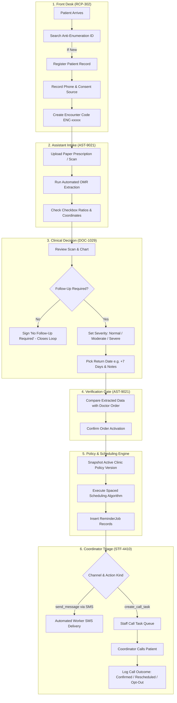
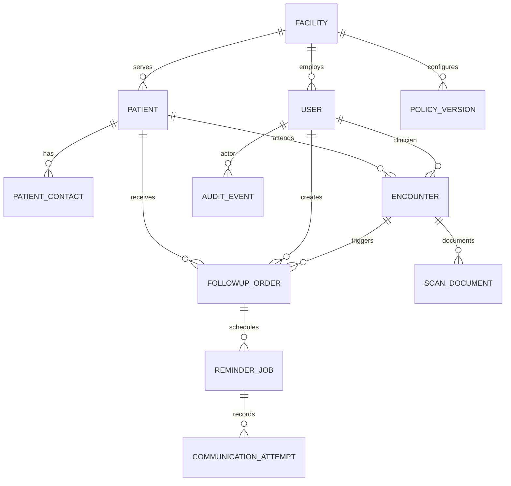

# CareTrack: Clinical Follow-Up & Intake Management System

> [!IMPORTANT]
> ### 🤖 MANDATORY INSTRUCTION FOR ALL AI CODING AGENTS & ASSISTANTS
> **Whenever you make ANY changes to this codebase (including new features, bug fixes, schema modifications, API endpoint updates, scheduling logic adjustments, or configuration changes), you MUST immediately update this `README.md` file.**
> 
> Keep this document fully synchronized, accurate, and self-contained so that any subsequent AI model or developer can immediately understand the complete operational, architectural, and clinical workflow of CareTrack without needing to explore or re-read the entire codebase.

---

## 1. Executive System Overview & Mission

**CareTrack** is an enterprise-grade, offline-capable clinical follow-up coordination and intake management system developed for hospital outpatient clinics (OPDs) and regional healthcare pilots.

### The Problem It Solves
In outpatient setups (especially rural and semi-urban facilities), paper prescription cards and clinical notes often get lost or disconnected from patient communication. Patients miss critical follow-up visits, resulting in complications. CareTrack bridges this physical-to-digital divide:
1. **Front-Desk Patient Registration:** Secure demographic recording with phone verification and anti-enumeration protections.
2. **Scan Intake & OMR/OCR Extraction:** Assistants upload physical discharge and prescription slips; automated OMR reads checkboxes while Tesseract extracts constrained fields.
3. **Clinician Authorization:** Doctors sign off on whether a follow-up is clinically necessary, assign a risk severity (`normal`, `moderate`, `severe`), and set return dates.
4. **Assistant Double-Check:** Verifiers confirm extracted data against doctor orders before any order is activated.
5. **Policy Governance:** Clinic supervisors establish and approve versioned reminder cadence algorithms and contact hours (`09:00 - 17:00`).
6. **Spaced & Fractional Outreach Engine:** Background worker queues automated SMS notifications and schedules coordinator phone call tasks.
7. **Coordinator Outreach Board:** Frontline staff manage call queues, record patient outcomes (confirmed, reschedule, opt-out), and handle escalations.
8. **Immutable Audit Trail:** Append-only log of every data alteration, login, and consent modification for regulatory and HIPAA compliance.

---

## 2. High-Level Technology Stack & Directory Structure

```
                  ┌─────────────────────────────────────────────────────────┐
                  │           React 19 + Vite + Tailwind Frontend           │
                  │       (7 Role Dashboards, Live Polling, Port 5173)      │
                  └────────────────────────────┬────────────────────────────┘
                                               │ HTTP / REST (JWT Bearer Auth)
                                               ▼
                  ┌─────────────────────────────────────────────────────────┐
                  │                 FastAPI Python Backend                  │
                  │   (RBAC, Pydantic v2, AES-GCM / Fernet, Port 8000)      │
                  └────────────────────────────┬────────────────────────────┘
                                               │ SQLAlchemy 2.0 ORM
                                               ▼
                  ┌─────────────────────────────────────────────────────────┐
                  │                 SQLite / PostgreSQL DB                  │
                  │           (backend/followup.db - Single Truth)          │
                  └─────────────────────────────────────────────────────────┘
```

### Directory Map
```
IIIT-Offline/
├── README.md                      # Primary architectural & operational blueprint (THIS FILE)
├── RUN_BACKEND_INSTRUCTIONS.txt   # Backend setup manual
├── backend/                       # FastAPI application root
│   ├── .env                       # Local environment secrets & database URLs
│   ├── alembic.ini                # Alembic database migration config
│   ├── pyproject.toml             # Python package dependencies
│   ├── app/
│   │   ├── main.py                # FastAPI app initialization, middleware, routes
│   │   ├── db.py                  # SQLAlchemy sessionmaker & SQLite/Postgres engine
│   │   ├── models.py              # Declarative database models (10 tables)
│   │   ├── schemas.py             # Pydantic v2 request/response validation schemas
│   │   ├── audit.py               # Audit event recording helpers
│   │   ├── api/                   # REST API route handlers
│   │   │   ├── auth.py            # Unique-ID login, me endpoint, staff registrations
│   │   │   ├── clinical.py        # Patients, encounters, follow-ups CRUD
│   │   │   ├── contacts.py        # Patient phone contacts & consent preferences
│   │   │   ├── scans.py           # Scan upload, OMR execution, assistant verification
│   │   │   ├── reminders.py       # Outreach queue, call outcomes, retries
│   │   │   ├── policies.py        # Policy authoring, approvals, activation
│   │   │   └── operations.py      # Clinic-wide roll-up KPI summaries
│   │   ├── core/                  # Security, cryptography, and settings
│   │   │   ├── config.py          # Pydantic settings management
│   │   │   ├── crypto.py          # AES-256-GCM / Fernet & HMAC phone fingerprinting
│   │   │   └── security.py        # PBKDF2 password hashing & JWT handling
│   │   ├── services/              # Business logic & background workers
│   │   │   ├── scheduling.py      # Spaced & fractional reminder schedule generator
│   │   │   ├── worker.py          # Background polling worker for reminders & scans
│   │   │   ├── omr.py             # Optical Mark Recognition & bubble analysis
│   │   │   ├── storage.py         # Encrypted scan file storage
│   │   │   └── time_utils.py      # UTC normalization & naive SQLite datetime handling
│   │   └── workers/
│   │       └── runner.py          # Standalone background worker entrypoint
│   ├── migrations/                # Alembic database migrations
│   └── scripts/                   # Bootstrap seeding and verification scripts
│       ├── bootstrap.py           # Database seeder (staff users, policy, test patients)
│       ├── verify_full_system_repairs.py  # E2E system repair verification test
│       └── verify_full_e2e_data_flows.py  # Comprehensive HTTP & DB flow test
│
└── frontend/                      # React 19 Client SPA
    ├── package.json               # Frontend dependencies & scripts
    ├── vite.config.ts             # Vite bundler config with /api & /health reverse proxy
    ├── scripts/
    │   └── verify-integration.mjs # 30-scenario contract & schema verification suite
    └── src/
        ├── main.tsx               # DOM entrypoint
        ├── App.tsx                # Main container & authoritative role dashboard router
        ├── api/                   # Typed API client functions (REST requests)
        ├── context/               # React Contexts (AuthContext, ToastContext)
        ├── hooks/                 # Custom React hooks (useLiveRefresh for auto-sync)
        ├── components/            # Reusable UI components (LiveStatusPill, Modals)
        ├── screens/               # 7 Dedicated Role Dashboards
        │   ├── DoctorDashboardScreen.tsx      # Clinician orders & decisions
        │   ├── AssistantIntakeScreen.tsx      # Scan intake, OMR, verification
        │   ├── ReceptionDeskScreen.tsx        # Front-desk patient registration
        │   ├── CoordinatorTriageScreen.tsx    # Reminder queue & staff call logging
        │   ├── StaffHeadDashboardScreen.tsx   # Policy governance & supervisor escalation
        │   ├── ITHeadAdminScreen.tsx          # Staff identities, ID allotment, revocation
        │   └── AuditorScreen.tsx              # Tamper-evident immutable audit logs
        └── sections/              # Public marketing homepage sections
```

---

## 3. Pre-Provisioned Staff Identities & Role Matrix

CareTrack uses an **Authoritative Unique-ID Authentication** model. Users sign in using only their system-assigned **Generated Unique ID** and password. They never select a role from a dropdown.

> **Universal Development Password for all seeded accounts:** `CareTrack@2026`

| Generated Unique ID | Staff Name | Backend Role (`User.role`) | Department | Dashboard Screen | Key Responsibilities & Permissions |
| :--- | :--- | :--- | :--- | :--- | :--- |
| **`DOC-1029`** | Dr. Amelia Reed | `doctor` | Cardiology | [`DoctorDashboardScreen.tsx`](frontend/src/screens/DoctorDashboardScreen.tsx) | Signs clinical follow-up decisions, reviews patient histories, reschedules/completes orders. |
| **`AST-9021`** | Dr. Marcus Chen | `assistant_verifier` | Emergency Medicine | [`AssistantIntakeScreen.tsx`](frontend/src/screens/AssistantIntakeScreen.tsx) | Uploads paper prescription scans, executes OMR extraction, verifies fields against doctor decisions. |
| **`STF-4410`** | James Okafor | `followup_coordinator` | Laboratory | [`CoordinatorTriageScreen.tsx`](frontend/src/screens/CoordinatorTriageScreen.tsx) | Monitors scheduled reminders, executes manual staff phone calls, records patient call outcomes. |
| **`HD-101`** | Nadia Williams | `clinic_supervisor` | Nursing Operations | [`StaffHeadDashboardScreen.tsx`](frontend/src/screens/StaffHeadDashboardScreen.tsx) | Authors, reviews, and activates clinic reminder policies; handles escalation and unblocking. |
| **`RCP-302`** | Priya Nair | `receptionist` | Front Office | [`ReceptionDeskScreen.tsx`](frontend/src/screens/ReceptionDeskScreen.tsx) | Front-desk patient registration, anti-enumeration search, records consent-backed phone numbers. |
| **`ITH-001`** | IT Head | `system_admin` | Security Operations | [`ITHeadAdminScreen.tsx`](frontend/src/screens/ITHeadAdminScreen.tsx) | Allots system IDs to new staff, approves registration requests, revokes or restores access. |
| **`AUD-001`** | Compliance Auditor | `auditor` | Compliance | [`AuditorScreen.tsx`](frontend/src/screens/AuditorScreen.tsx) | Read-only inspection of immutable audit events, security modifications, and clinical decisions. |

### Public Staff Registration & ID Allotment Flow
1. New hospital staff submit an onboarding request at `POST /api/v1/auth/register-request` (via the Register tab on the Login Modal).
2. The request enters `registration_requests` table with `status = "pending"`.
3. The IT Head (`ITH-001`) reviews the request in [`ITHeadAdminScreen.tsx`](frontend/src/screens/ITHeadAdminScreen.tsx).
4. Upon clicking **"Allot Unique ID"** (`POST /api/v1/admin/registration-requests/{id}/approve`), the backend generates a permanent ID prefix (`DOC-`, `AST-`, `STF-`, `RCP-`, etc.) and activates the account.

---

## 4. End-to-End Clinical Follow-Up Workflow



---

## 5. Reminder Scheduling Logic & Algorithms

CareTrack supports two scheduling modes governed by the active clinic policy ([`backend/app/services/scheduling.py`](backend/app/services/scheduling.py)):

### A. Spaced Scheduling Mode (`schedule_mode: "spaced"` — Current Active Default)

Spaced scheduling spaces outreach events proportionally across the timeline:

1. **Forward 2-Day Cadence:**
   Reminders are scheduled **2 days apart** starting from Day 2 after the encounter date:
   $$\text{Offsets: } \text{Day 2, Day 4, Day 6, Day 8,}\dots$$
2. **Guaranteed 1-Day-Before Final Reminder:**
   A final reminder is **always scheduled exactly 1 day before the appointment** ($\text{Day } N - 1$):
   - **Odd Total Days ($N=7$):** Offsets: `[Day 2, Day 4, Day 6]`. (Day 6 is 2 days after Day 4, and exactly 1 day before Day 7).
   - **Even Total Days ($N=6$):** Offsets: `[Day 2, Day 4, Day 5]`. (Day 2 and Day 4 are 2 days apart; Day 5 provides the guaranteed 1-day-before reminder).
   - **Short Intervals ($N \le 1$):** Triggers `short_interval_action = "call_task"`, immediately creating a staff call task for the Coordinator.

#### Spaced Offset Lookup Matrix
| Total Window ($N$) | Window Type | Scheduled Checkpoint Offsets (Days from Visit) | Final Reminder |
| :---: | :---: | :--- | :--- |
| **2 Days** | *Even* | `[Day 1]` | Day 1 (1 day before) |
| **3 Days** | *Odd* | `[Day 2]` | Day 2 (1 day before) |
| **4 Days** | *Even* | `[Day 2, Day 3]` | Day 3 (1 day before) |
| **5 Days** | *Odd* | `[Day 2, Day 4]` | Day 4 (1 day before) |
| **6 Days** | *Even* | `[Day 2, Day 4, Day 5]` | Day 5 (1 day before) |
| **7 Days** | *Odd* | `[Day 2, Day 4, Day 6]` | Day 6 (1 day before) |
| **10 Days** | *Even* | `[Day 2, Day 4, Day 6, Day 8, Day 9]` | Day 9 (1 day before) |
| **14 Days** | *Even* | `[Day 2, Day 4, Day 6, Day 8, Day 10, Day 12, Day 13]` | Day 13 (1 day before) |

3. **Operating Hours (Quiet Hours Enforcement):**
   Messages and scheduled call tasks are pinned to `09:00 AM` local time (`Asia/Kolkata`) within the allowed window (`09:00 - 17:00`). Messages are never dispatched at night.

4. **Severity-Based Action Mapping:**
   - **`normal`:** All checkpoints are automated **SMS messages** (`channel: "sms"`, `action_kind: "send_message"`).
   - **`moderate`:** Initial checkpoints are SMS; the final checkpoint(s) before the visit escalate to **staff phone call tasks** (`channel: "staff_call"`, `action_kind: "create_call_task"`).
   - **`severe`:** Dispatches an immediate SMS at $t=0$, and **all subsequent checkpoints become staff call tasks** requiring verbal human confirmation.

---

### B. Fractional Cadence Mode (`schedule_mode: "fractional"`)

If a clinic supervisor explicitly configures a policy with fractional mode:
$$\text{Fractions: } [0.29,\ 0.57,\ 0.79,\ 0.86,\ 0.93]$$
$$\text{offset\_days} = \max\left(1,\ \left\lfloor \text{total\_days} \times f_i + 0.5 \right\rfloor\right)$$

---

## 6. Complete Database Schema (SQLAlchemy Models)

The SQLite database file is located at `backend/followup.db` (configured via `DATABASE_URL` in `backend/.env`).



### Key Table Specifications

| Model / Table | Primary Key | Key Columns & Types | Constraints & Foreign Keys |
| :--- | :--- | :--- | :--- |
| **`facilities`** | `id` (UUID) | `name` (Str), `timezone` (Str, def "Asia/Kolkata"), `active` (Bool) | Unique facility identity. |
| **`users`** | `id` (UUID) | `system_identifier` (Str UNIQUE, e.g. `DOC-1029`), `username`, `display_name`, `role`, `department`, `password_hash`, `work_email`, `status` (`active`\|`revoked`), `is_active` (Bool) | `FK -> facilities.id`. Role CHECK: `doctor`, `assistant_verifier`, `followup_coordinator`, `clinic_supervisor`, `system_admin`, `auditor`, `receptionist`. |
| **`registration_requests`** | `id` (UUID) | `full_name`, `work_email`, `department`, `requested_role`, `password_hash`, `certification_agreed` (Bool), `status` (`pending`\|`approved`\|`rejected`), `rejection_reason` | `FK -> facilities.id`, `FK -> users.id` (`reviewed_by_user_id`). |
| **`patients`** | `id` (UUID) | `hospital_patient_identifier` (Str, e.g. `PT-20496`), `display_name`, `date_of_birth` (Date), `identity_status` (`verified`\|`pending`) | `FK -> facilities.id`. Unique (`facility_id`, `hospital_patient_identifier`). |
| **`patient_contacts`** | `id` (UUID) | `channel` (`voice`\|`sms`), `destination_encrypted` (Ciphertext), `destination_fingerprint` (HMAC), `is_shared` (Bool), `sharing_status_source`, `verified` (Bool), `verification_source` | `FK -> patients.id`. Contact numbers encrypted via AES-256-GCM / Fernet. |
| **`communication_preferences`** | `id` (UUID) | `channel`, `purpose` (def `"appointment_reminder"`), `permission_status` (`opted_in`\|`opted_out`), `evidence_type`, `evidence_reference` | `FK -> patient_contacts.id`. Enforces explicit consent. |
| **`encounters`** | `id` (UUID) | `external_encounter_identifier` (Str, e.g. `ENC-20496`), `encounter_at` (DateTime), `status` (Str) | `FK -> patients.id`, `FK -> users.id` (`clinician_user_id`). |
| **`scan_documents`** | `id` (UUID) | `form_identifier`, `form_version`, `storage_key`, `sha256`, `mime_type`, `processing_status` (`uploaded`\|`queued_for_processing`\|`processing`\|`verified`\|`processing_failed`), `extracted_fields` (JSON) | `FK -> encounters.id`, `FK -> users.id` (submitter & reviewer). |
| **`followup_orders`** | `id` (UUID) | `followup_required` (Bool), `severity` (`normal`\|`moderate`\|`severe`), `scheduled_at` (DateTime), `status` (`active`\|`completed`\|`cancelled`\|`contact_resolution_required`), `revision` (Int) | `FK -> patients.id`, `FK -> encounters.id`, `FK -> policy_versions.id`. |
| **`reminder_jobs`** | `id` (UUID) | `sequence_no` (Int), `channel` (`sms`\|`staff_call`), `action_kind` (`send_message`\|`create_call_task`), `scheduled_at` (DateTime), `status` (`scheduled`\|`call_task_open`\|`completed`\|`suppressed`\|`retry_wait`), `idempotency_key` (Str UNIQUE) | `FK -> followup_orders.id`, `FK -> policy_versions.id`. Deterministic idempotency key prevents duplicate scheduling. |
| **`communication_attempts`** | `id` (UUID) | `attempt_no` (Int), `channel`, `result` (`sent`\|`delivered`\|`failed`\|`suppressed`), `error_code`, `finished_at` (DateTime) | `FK -> reminder_jobs.id`. Historical record of dispatch outcomes. |
| **`policy_versions`** | `id` (UUID) | `name`, `version` (Int), `config` (JSON), `is_active` (Bool), `effective_from` (DateTime), `approval_reference` (Str) | `FK -> facilities.id`. Stores intervals, contact hours, and actions. |
| **`audit_events`** | `id` (UUID) | `actor_type` (`staff`\|`service`), `action` (Str), `entity_type` (Str), `entity_id` (UUID), `change_summary` (JSON), `created_at` (DateTime) | Append-only. Protected by DB-level trigger on PostgreSQL or immutable ORM contract. |

---

## 7. Verified API Endpoint Reference Table

| Category | HTTP Method & Route | Access Roles | Request Body / Query Params | Primary Action / Database Impact |
| :--- | :--- | :--- | :--- | :--- |
| **Auth** | `POST /api/v1/auth/login` | Public | `{ unique_id, password }` | Authenticates staff; returns JWT access token (`expires_in: 900`). |
| **Auth** | `GET /api/v1/me` | Authenticated | *Bearer Token* | Returns active staff profile, system ID, role, and permission list. |
| **Auth** | `POST /api/v1/auth/register-request` | Public | `{ full_name, work_email, department, requested_role, password, certification_agreed }` | Inserts pending record into `registration_requests`. Stages identity in Supabase (banned until approved). |
| **Auth** | `POST /api/v1/auth/forgot-password` | Public | `{ identity }` | Initiates password recovery (email dispatch via Supabase or signed reset token in dev). Anti-enumeration protected. |
| **Auth** | `POST /api/v1/auth/reset-password` | Public | `{ token, new_password }` | Validates signed reset token; updates local password hash and synchronizes with Supabase Auth. |
| **Admin** | `GET /api/v1/admin/registration-requests` | `system_admin` | *None* | Lists all pending onboarding requests. |
| **Admin** | `POST /api/v1/admin/registration-requests/{id}/approve` | `system_admin` | *None* | Allots Generated Unique ID; activates account in `users` and unbans user in Supabase. |
| **Admin** | `POST /api/v1/users/{id}/revoke` | `system_admin` | `{ reason }` | Deactivates staff access (`status: "revoked"`, `is_active: false`); bans user in Supabase. |
| **Admin** | `POST /api/v1/users/{id}/restore` | `system_admin` | `{ reason }` | Restores revoked staff access (`status: "active"`, `is_active: true`); unbans user in Supabase. |
| **Clinical** | `GET /api/v1/patients` | Staff | Query: `hospital_patient_identifier` | Anti-enumeration lookup; returns patient record or 404. |
| **Clinical** | `POST /api/v1/patients` | `receptionist`, `assistant_verifier`, `doctor` | `{ hospital_patient_identifier, display_name, date_of_birth }` | Creates patient demographic chart. |
| **Clinical** | `POST /api/v1/patients/{id}/contacts` | `receptionist`, `assistant_verifier` | `{ channel, destination, is_shared, sharing_status_source, verified, verification_source }` | Normalizes to E.164, encrypts number, stores HMAC fingerprint. |
| **Clinical** | `POST /api/v1/encounters` | `assistant_verifier`, `doctor` | `{ patient_id, external_encounter_identifier, clinician_user_id?, encounter_at }` | Links clinical visit to patient (auto-assigns doctor if clinician omitted). |
| **Scans** | `POST /api/v1/scans` | `assistant_verifier` | Multipart Form: `file`, `form_identifier`, `form_version` | Uploads PDF/image scan to private encrypted storage. |
| **Scans** | `POST /api/v1/scans/{id}/process` | `assistant_verifier` | *None* | Enqueues scan for background OMR/OCR extraction. |
| **Scans** | `POST /api/v1/scans/{id}/decision` | `doctor` | `{ followup_required, severity, scheduled_at_local, timezone, reason }` | Authoritative clinician sign-off on follow-up requirements. |
| **Scans** | `POST /api/v1/scans/{id}/verify` | `assistant_verifier` | `{ identity_confirmed, fields_confirmed, encounter_id, patient_id }` | Validates extracted data matches doctor order; activates follow-up order. |
| **Orders** | `GET /api/v1/followups` | `doctor`, `followup_coordinator`, `clinic_supervisor` | Query: `status`, `limit`, `offset` | Retrieves active or pending follow-up orders. |
| **Orders** | `POST /api/v1/followups/{id}/reschedule` | `doctor`, `followup_coordinator` | `{ scheduled_at, reason, expected_revision }` | Increments revision, recalculates reminder jobs. |
| **Orders** | `POST /api/v1/followups/{id}/complete` | `doctor`, `followup_coordinator` | `{ outcome_category, clinical_notes }` | Closes order with evidence; cancels remaining reminder jobs. |
| **Orders** | `POST /api/v1/followups/{id}/cancel` | `doctor`, `clinic_supervisor` | `{ reason }` | Formally cancels follow-up with audit log reason. |
| **Reminders**| `GET /api/v1/reminders/queue` | `followup_coordinator` | Query: `status` (`scheduled`, `call_task_open`, `completed`) | Retrieves actionable patient outreach jobs. |
| **Reminders**| `POST /api/v1/reminders/{id}/call-outcomes` | `followup_coordinator` | `{ result, safe_result_notes, occurred_at }` | Records staff telephone call outcome and patient response. |
| **Policies** | `GET /api/v1/policies` | `clinic_supervisor`, `auditor`, `system_admin` | *None* | Lists versioned clinic follow-up policies. |
| **Policies** | `POST /api/v1/policies` | `clinic_supervisor`, `system_admin` | `{ name, config: PolicyConfig }` | Creates draft policy revision. |
| **Policies** | `POST /api/v1/policies/{id}/approve` | `clinic_supervisor` | `{ approval_reference }` | Activates policy revision for all subsequent orders. |
| **Ops** | `GET /api/v1/operations/summary` | `clinic_supervisor`, `system_admin` | *None* | Provides aggregate operational counters and queue depths. |
| **Audit** | `GET /api/v1/audit/events` | `auditor`, `clinic_supervisor`, `system_admin` | Query: `limit`, `offset` | Immutable compliance audit log trail. |

---

## 8. Critical Development Rules & Gotchas for AI Models

> [!CAUTION]
> ### 1. SQLite Naive Datetime Handling
> SQLite does not natively store timezone offsets. When SQLAlchemy reads datetimes from SQLite, Python returns naive `datetime` objects (`tzinfo is None`).
> **Always use `to_utc()` from [`backend/app/services/time_utils.py`](backend/app/services/time_utils.py):**
> ```python
> def to_utc(value: datetime) -> datetime:
>     if value.tzinfo is None:
>         return value.replace(tzinfo=timezone.utc)
>     return value.astimezone(timezone.utc)
> ```
> Never raise a 422 error for naive datetimes read from the database.

> [!WARNING]
> ### 2. Contact Phone & Consent Requirements
> Endpoint `POST /api/v1/patients/{patient_id}/contacts` strictly enforces data privacy rules:
> - If `is_shared == False`, `sharing_status_source` MUST be `"patient_direct_declaration"`.
> - If `is_shared == True`, `sharing_status_source` MUST specify the relationship (e.g. `"patient_declared_child"`, `"patient_declared_spouse"`).
> - If `verified == True`, `verification_source` MUST be provided (e.g. `"in_person_reception"`).
> - Phone numbers MUST be in E.164 international notation (`+919876543210`).

> [!NOTE]
> ### 3. Optional `clinician_user_id` on Encounter Submission
> When an assistant verifier (`AST-9021`) creates an encounter in Step 03 of intake, `clinician_user_id` is optional (`UUID | None = None`). The backend automatically assigns the active facility doctor (`DOC-1029`) if none is provided.

> [!IMPORTANT]
> ### 4. Windows Sandbox Networking
> In Windows PowerShell sandboxes, commands making HTTP connections to `http://127.0.0.1:8000` or local loopback must run with `BypassSandbox: false` or appropriate socket permissions.

---

## 9. Local Execution & Development Runbook

### Prerequisites
* Python 3.12 or 3.13
* Node.js v18+ and npm / pnpm

### Step 1: Initialize Backend Python Virtual Environment
```powershell
# Create virtual environment in backend/.venv
py -3.13 -m venv backend/.venv

# Install backend dependencies in editable mode
backend\.venv\Scripts\pip.exe install -e backend
```

### Step 2: Configure Environment Variables
Copy `.env.example` to `.env` in both `backend/.env` and the root `.env`. Ensure absolute paths for SQLite:
```ini
ENVIRONMENT=development
DATABASE_URL=sqlite:///C:/Users/ASUS/Desktop/Projects/IIIT-Offline/backend/followup.db
AUTH_MODE=development
DEV_AUTH_SECRET=C4hokRRAtXYCGCuG_JnqXJdlEErX79ub9VmKye4o5UA
CONTACT_ENCRYPTION_KEY=egF97gWM1z52T_-DPckaDTTzVedEi4EU3FmEJbg1WBM=
CONTACT_FINGERPRINT_KEY=n_aDRBpuHjp0K5zrse98K8TaON7i8TPrx0hgZo7u93M
PROVIDER_WEBHOOK_SECRET=Hh8YwMKZP0gchvhjqaup8cgj2SPQDPRv-s13yBzdiNU
MESSAGING_PROVIDER=fake
OUTBOUND_MESSAGING_ENABLED=false
ALLOWED_HOSTS=["localhost","127.0.0.1","testserver"]
BOOTSTRAP_FACILITY_NAME=Local Development Clinic
BOOTSTRAP_FACILITY_TIMEZONE=Asia/Kolkata
```

### Step 3: Initialize Database & Seed Demo Data
```powershell
# Run database schema migrations
cd backend
..\backend\.venv\Scripts\alembic.exe upgrade head

# Seed demo facility, 7 staff accounts, active policy, and 6 patient charts
..\backend\.venv\Scripts\python.exe -m scripts.bootstrap
cd ..
```

### Step 4: Install Frontend Dependencies
```powershell
cd frontend
npm install
cd ..
```

### Step 5: Start All 3 Services
```powershell
# 1. Start FastAPI Backend API (Port 8000)
backend\.venv\Scripts\uvicorn.exe app.main:app --app-dir backend --host 127.0.0.1 --port 8000

# 2. Start Background Worker Daemon (Polls every 5s for reminders & scan OMR)
$env:PYTHONPATH="backend"
backend\.venv\Scripts\python.exe -m app.workers.runner

# 3. Start React/Vite Frontend Server (Port 5173 with proxy to 8000)
npm run dev --prefix frontend
```

---

## 10. Automated Test Suites & Quality Verification

Run these suites after making any code modifications to ensure zero regressions:

```powershell
# 1. Frontend Integration Test Suite (Tests 30 contract & state machine scenarios)
cd frontend
npm test

# 2. Production Frontend Bundle Build & TypeScript Check
npm run build
cd ..

# 3. Python End-to-End System Repair Verification Suite
backend\.venv\Scripts\python.exe backend/scripts/verify_full_system_repairs.py

# 4. Comprehensive 26-Check HTTP Data Flow Suite
backend\.venv\Scripts\python.exe backend/scripts/verify_full_e2e_data_flows.py
```

---

## 11. Supabase Auth Integration, IT Admin Gatekeeper Authority & Password Reset

### Dual-Mode Authentication Architecture
CareTrack incorporates a zero-breakage, dual-mode authentication system that seamlessly supports both enterprise Supabase Auth cloud deployments and isolated offline clinic environments:

1. **When Supabase is Configured (`SUPABASE_URL` and `SUPABASE_SERVICE_ROLE_KEY` defined):**
   - User account lifecycle and password recovery are synchronized with Supabase Auth via native Admin and Anon REST endpoints.
   - Credentials can be validated directly against Supabase Auth.
   - Password recovery emails are dispatched via Supabase's managed recovery infrastructure.
2. **When Supabase is Unset (Offline / Local / Development Fallback):**
   - Full failover to local PBKDF2-SHA256 password hashing.
   - Self-contained, cryptographically signed JWT password reset tokens (`purpose: "password_reset"`, 15-minute expiration) are generated and verified locally.
   - Guarantees 100% functionality and passing test suites in sandboxed, offline, or private network clinics without network access.

```
       [ Public Registration ]
                 │
                 ▼
       ┌──────────────────┐
       │ Status: pending  │ ◄── [ Supabase Account Created in BANNED State ]
       └─────────┬────────┘
                 │
      [ IT Admin Review ]
                 │
        ┌────────┴────────┐
        │                 │
  (Rejection)        (Approval)
        │                 │
        ▼                 ▼
 ┌─────────────┐   ┌───────────────────────────────┐
 │  Rejected   │   │ Status: active                │
 │ (No Access) │   │ Generated Unique ID (e.g. DOC)│
 └─────────────┘   │ Supabase Account UNBANNED     │
                   └──────────────┬────────────────┘
                                  │
                       ┌──────────┴──────────┐
                       │                     │
                 (Revoke Access)      (Restore Access)
                       │                     │
                       ▼                     ▼
               ┌───────────────┐     ┌───────────────┐
               │Status: revoked│     │Status: active │
               │Supabase BANNED│     │Supabase UNBAN │
               └───────────────┘     └───────────────┘
```

### Strict IT Admin Gatekeeper Authority
Clinical safety policies strictly mandate that public self-registrations cannot immediately sign in or access patient records:
- **Registration Request (`POST /api/v1/auth/register-request`):**
  - Clinicians submit work email, role, department, password, and legal certification.
  - Saved as a `pending` record in `registration_requests`.
  - When Supabase is configured, the identity is staged in Supabase Auth but immediately **banned** (`ban_duration: "876000h"`).
- **IT Admin Approval (`POST /api/v1/admin/registration-requests/{id}/approve`):**
  - Only users with `user:manage` permissions (e.g., IT Head `ITH-001`) can approve requests.
  - On approval, the system generates a role-prefixed Unique ID (e.g., `DOC-4921`, `AST-3012`, `RCP-1044`), provisions the active `User` account, unbans the user in Supabase, and writes an audit event.
- **IT Admin Revocation & Resumption:**
  - `POST /api/v1/users/{id}/revoke`: Immediately deactivates local user (`is_active = false`, `status = "revoked"`) and bans the user in Supabase. Revoked users are barred from logging in or resetting passwords.
  - `POST /api/v1/users/{id}/restore`: Restores active status (`is_active = true`, `status = "active"`) and unbans the user in Supabase.

### Forgot Password & Password Reset Workflow
1. **Request (`POST /api/v1/auth/forgot-password`):**
   - User inputs either their Generated Unique ID (e.g. `DOC-1029`) or registered Work Email.
   - **Anti-Enumeration Guard:** The endpoint always returns a uniform message (`"If an authorized active account matches the details provided, password reset instructions have been generated."`) regardless of whether the account exists or is active.
   - Revoked or inactive accounts are rejected silently to prevent unauthorized password updates.
   - If Supabase is configured, an email recovery link is sent. In development / offline mode, a signed reset JWT is issued.
2. **Reset (`POST /api/v1/auth/reset-password`):**
   - Accepts `{ token, new_password }`.
   - Validates that token has `purpose == "password_reset"`, is unexpired, and signature is valid.
   - Confirms user account is currently active (`is_active == True` and `status == "active"`).
   - Hashes and updates `user.password_hash` in CareTrack database, and synchronizes the password in Supabase via `supabase_admin_update_password`.
   - Records an immutable audit event (`auth.password_reset_completed`).

### Frontend & Backend Security Best Practices Enforced
- **Zero Secrets in Frontend:** The Supabase Service Role Key (`SUPABASE_SERVICE_ROLE_KEY`) is stored strictly on the server backend and never bundled or exposed to Vite or browser clients.
- **Fail-Closed Authorization:** Every protected route verifies JWT expiration, signature, and checks `user.is_active` in the database.
- **Rate Limiting:** IP-level sliding window rate limiters protect `/auth/login` and `/auth/forgot-password` against brute force.
- **Vercel Hot-Reload & Deployment Reliability:**
  - Native typed fetch client avoids bulky external npm dependencies that could cause package version conflicts or failed Vercel builds.
  - TypeScript types (`tsc --noEmit`) and Vite production bundle tests pass with 0 errors.
